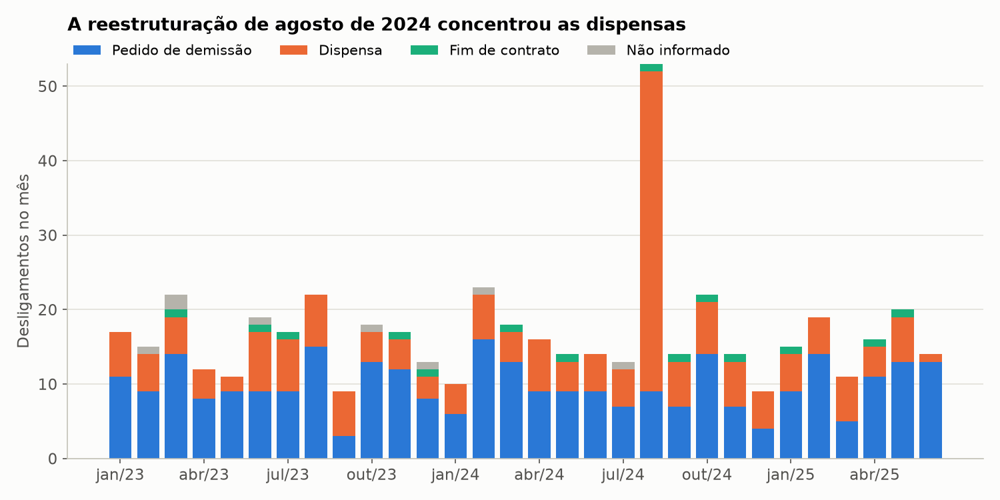
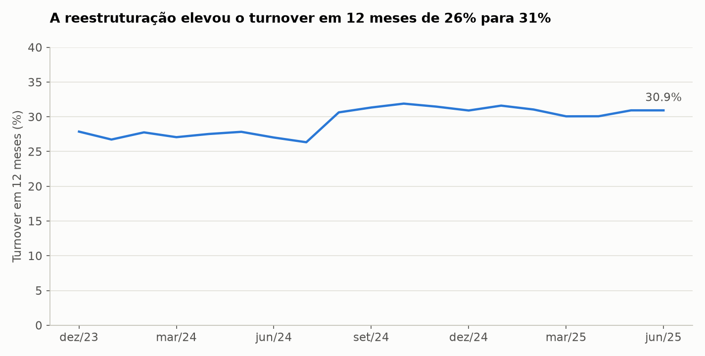
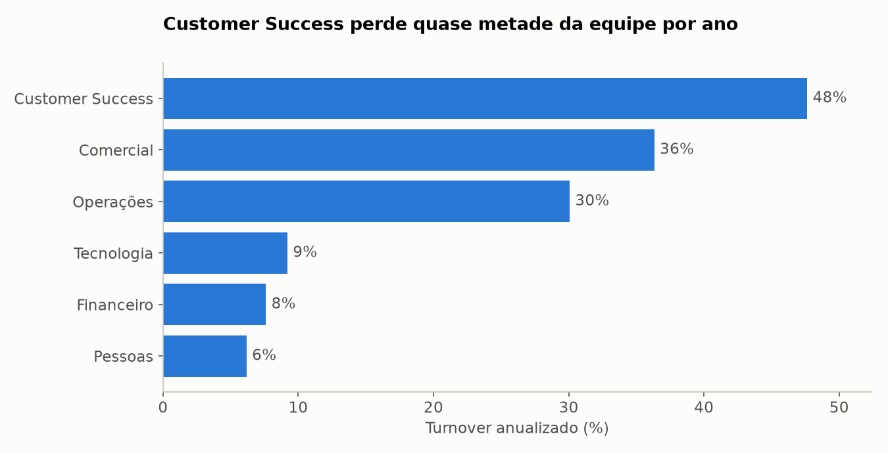
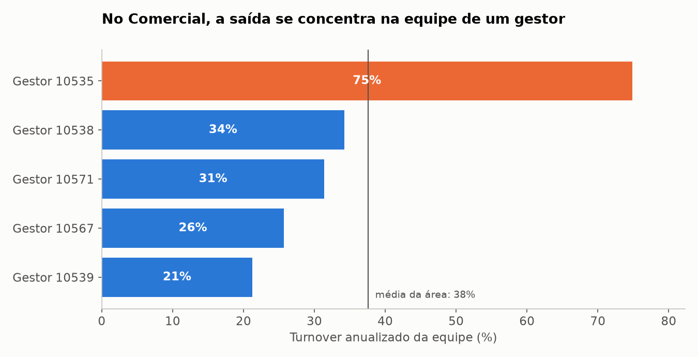
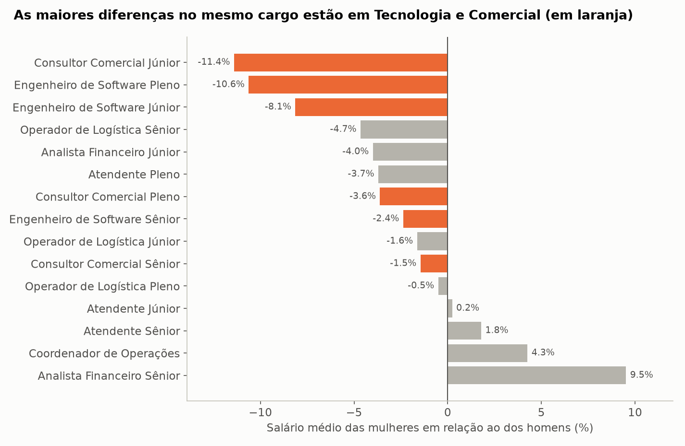
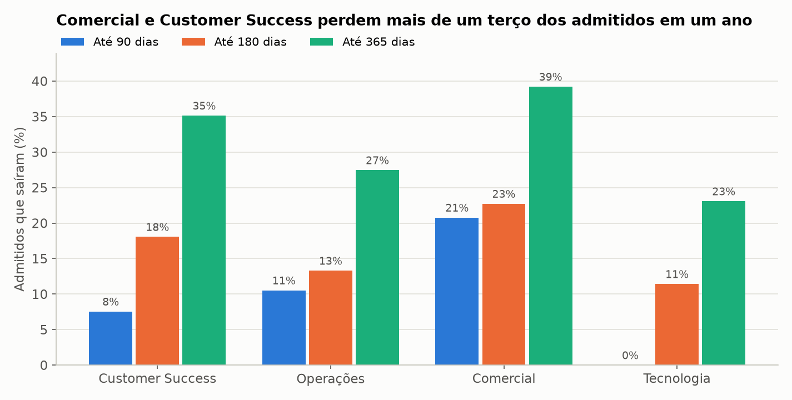

# 07 · HR + PostgreSQL

Pipeline de RH que transforma 30 fotos mensais de cadastro em um histórico confiável no PostgreSQL,
com constraints, upserts, SCD tipo 2, indicadores em SQL e uma base anonimizada para o analista.

## Problema e contexto

A **Nortia Serviços** (empresa fictícia) tem cerca de 720 colaboradores e trocou de sistema de RH em
janeiro de 2024. O sistema só exporta uma foto mensal de quem está na empresa, sem histórico. Isso
deixa sem resposta perguntas simples: qual era o cargo de alguém em março do ano passado, quantas
pessoas saíram de verdade e quem continua na folha depois de sair.

O objetivo é reconstruir essa linha do tempo em um banco que recuse dado inválido, calcular turnover
e diferença salarial, auditar a folha e dar acesso ao analista sem expor dados pessoais.

## Origem dos dados

Os dados são sintéticos, gerados por `scripts/generate_data.py` com semente fixa. A simulação cria
a verdade mês a mês, com admissões, promoções, dissídio, saídas e recontratações, e só depois suja a
exportação. O gabarito em `data/external` permite conferir o que o pipeline recuperou.

| Fonte | Formato | Volume |
|---|---|---|
| Foto mensal do RH, até dez/2023 | CSV latin-1, ponto e vírgula, datas brasileiras, maiúsculas | 12 arquivos |
| Foto mensal do RH, desde jan/2024 | CSV UTF-8, vírgula, datas ISO, CPF com máscara | 18 arquivos |
| Folha de pagamento | CSV mensal, números no padrão brasileiro | 21.666 linhas |
| Afastamentos | JSON aninhado por matrícula | 2.014 registros |

## Problemas encontrados e tratamento

| Problema | Tratamento |
|---|---|
| Dois sistemas com encoding, separador, datas e colunas diferentes | o formato é reconhecido pelo cabeçalho e os dois viram um só |
| Cargos abreviados (`ENG SOFTWARE JR`) e sem acento | de-para gerado a partir de `config/rh.yaml` |
| CPF sem zero à esquerda no sistema antigo | zeros recuperados antes de validar os dígitos |
| Atendimento renomeado para Customer Success | código estável da área: o nome muda sem criar nova versão |
| 53 linhas repetidas com dados antigos | vale a de vigência mais recente |
| 29 salários digitados errado, 10 vezes maiores ou menores | faixa salarial por cargo; a versão anterior continua valendo |
| 12 CPFs inválidos e 12 admissões no futuro | quarentena, e a linha é corrigida na foto seguinte |
| 15 gestores inexistentes | mantém o gestor anterior e registra o caso |
| 17 promoções lançadas com atraso | a versão usa a data de vigência, e `registrado_em` guarda quando a informação chegou |
| 8 pessoas que somem do arquivo sem data de saída | saída inferida, com motivo "Não informado" e marcação própria |
| 16 recontratações | mesma pessoa, nova matrícula, sem sobreposição de vínculos |
| Gerente subordinado à própria equipe em mar/abr de 2024 | ciclo detectado com a cláusula `CYCLE` do PostgreSQL |
| Afastamentos repetidos, invertidos, sem fim ou sobrepostos | quarentena; a sobreposição é decidida pela própria constraint |
| CID nos atestados | dado de saúde sem uso aqui, descartado já na leitura |

Uma armadilha do formato: linha rejeitada não é desligamento. Por isso as matrículas de todo o
arquivo vão para `staging.presenca`, e a inferência de saída só olha quem realmente sumiu.

## Modelagem

```text
rh.pessoa ──1:N── rh.vinculo ──1:N── rh.historico_posicao ──N:1── rh.cargo
(CPF, nome)       (matrícula,        (SCD tipo 2: versões    ──N:1── rh.departamento
                  admissão, saída)   com valido_de/valido_ate)──N:1── rh.unidade
                       │
                       ├──1:N── rh.folha
                       └──1:N── rh.afastamento
```

| Esquema | Conteúdo | Quem acessa |
|---|---|---|
| `staging` | foto limpa da competência, descartável | pipeline |
| `rh` | modelo com dados pessoais | pipeline |
| `etl` | controle de carga, quarentena e auditoria, sem nome nem CPF | pipeline |
| `analytics` | views de indicadores | analista, só as agregadas |
| `anon` | base anonimizada | analista |

## Decisões de engenharia

- **O banco é a última barreira.** A limpeza fica no Pandas, mas as regras também estão no banco:
  CPF validado por função, salário mínimo, folha que precisa fechar a conta e chaves estrangeiras.
- **Exclusion constraints.** `EXCLUDE USING gist` impede períodos sobrepostos no histórico, nos
  vínculos da mesma pessoa e nos afastamentos. Um `UNIQUE` comum não consegue expressar isso.
- **SCD tipo 2 em SQL.** Cada foto roda em uma transação: fecha a versão de quem mudou e abre a nova.
  Área renomeada e nome corrigido são atualizações simples (tipo 1) e não criam versão.
- **Duas datas por versão.** `valido_de` diz quando a mudança passou a valer, e `registrado_em` diz
  quando chegou. É assim que a promoção atrasada fica certa e continua visível.
- **Upserts que não fazem nada à toa.** `ON CONFLICT DO UPDATE ... WHERE ... IS DISTINCT FROM` evita
  regravar linhas iguais e não polui a auditoria.
- **Carga controlada.** Foto repetida é ignorada pelo hash. Foto fora de ordem ou alterada depois de
  carregada é erro, porque o histórico depende da sequência.
- **Migrações versionadas.** Arquivos SQL numerados, com hash. Alterar uma migração já aplicada é erro.
- **Carga com COPY.** É o caminho mais rápido para o PostgreSQL: os 30 meses carregam em cerca de 3 segundos.

### SQL usado

`EXCLUDE`, `ON CONFLICT`, `daterange`, `CYCLE`, `WITH RECURSIVE`, window functions, `FILTER`,
`DISTINCT ON`, `LATERAL`, materialized view, trigger de auditoria, `GRANT` e `hmac` do pgcrypto.

## Anonimização (LGPD)

- **Acesso por papel.** O papel `rh_analista` só lê `anon` e as views agregadas. Os testes confirmam
  que ele não abre `rh.pessoa`, a folha ou as views com matrícula.
- **Pseudônimo com HMAC.** Sem a chave, que fica no ambiente, não dá para refazer o cálculo a partir
  das matrículas. Um hash simples de matrícula seria quebrado por tentativa.
- **Generalização.** Idade, tempo de casa e salário viram faixas.
- **k-anonimato.** Toda combinação de área, grupo de nível, faixa etária e gênero tem pelo menos 5
  pessoas. Dos 1.230 vínculos, 63 ficaram de fora e 1.167 foram publicados.
- **Minimização.** A quarentena e a auditoria não guardam nome, CPF nem nascimento.

## Arquitetura

```text
fotos CSV ─┐
folha CSV ─┤ extract ─▶ clean ─▶ staging ─▶ SCD tipo 2 ─▶ rh.* ─▶ analytics.* ─▶ relatório e gráficos
ponto JSON ┘            │                      (SQL)        │
                        ▼                                   └──▶ anon.colaborador ─▶ analista
                   etl.quarentena
```

```text
07-hr-postgresql/
├── config/rh.yaml        catálogos e regras
├── data/raw/             fotos, folha e afastamentos
├── docker-compose.yml    PostgreSQL 17
├── output/               relatório, tabelas, gráficos e manifesto
├── scripts/              gerador dos dados
├── sql/
│   ├── migrations/       esquema, modelo, controle, indicadores e LGPD
│   └── etl/              aplicar_foto.sql e anonimizar.sql
├── src/                  extract, clean, load, db, anonymize, quality, analyze, report, visualize
├── tests/
└── main.py
```

## Tecnologias

PostgreSQL 17, Docker Compose, Python 3.14, Pandas 3, psycopg 3, PyYAML, Matplotlib e pytest.

## Como executar

É preciso ter o Docker aberto. O `.env` é opcional: sem ele, valem os valores locais de `.env.example`.

```bash
python3 -m venv .venv
```

```bash
source .venv/bin/activate
```

```bash
pip install -r requirements.txt
```

```bash
docker compose up -d --wait
```

```bash
python main.py
```

```bash
pytest
```

Rodar `main.py` de novo não altera nada. Para apagar o banco e reprocessar tudo, use
`python main.py --recriar`. Para desligar o banco, use `docker compose stop`. Os testes criam bancos
próprios no mesmo container, e os que precisam do PostgreSQL são pulados se ele estiver fora do ar.

## Resultados obtidos

| Indicador | Valor |
|---|---|
| Linhas lidas nas fotos | 21.676 |
| Linhas aplicadas | 21.570 |
| Linhas em quarentena | 106 |
| Vínculos e pessoas | 1.230 e 1.214 |
| Versões no histórico | 3.211 |
| Headcount final | 723 |
| Desligamentos | 507 |
| Turnover em 12 meses | 30,9% |

### Turnover



Agosto de 2024 teve 53 saídas, 43 delas dispensas, contra cerca de 16 em um mês comum.



O indicador foi de 26,3% para 30,6% naquele mês e ficou nesse patamar. Parte disso é efeito da
janela: agosto de 2024 ainda está dentro dos 12 meses, então a taxa só deve cair quando ele sair.



Customer Success tem turnover anualizado de 48%, contra 9% em Tecnologia. Esse número inclui a
reestruturação, mas a taxa já era alta antes dela: 37%, empatada com o Comercial.

### Um gestor concentra as saídas no Comercial



A equipe do gestor 10535 tem turnover de 75%, com 29 saídas, contra 21% a 34% nas outras equipes da
área. O dado indica onde investigar, mas não prova a causa.

### Diferença salarial



Comparando pessoas no mesmo cargo, as mulheres ganham em média 7,4% menos em Tecnologia e 7,3% menos
no Comercial, ponderando pelo número de mulheres em cada cargo. Nas demais áreas, a diferença fica
entre -1,5% e +2,2%. Grupos pequenos oscilam bastante, como os +9,5% de Analista Financeiro Sênior.

### Saída no primeiro ano



Só entra em cada barra quem já teve tempo de completar o prazo. O Comercial perde 21% dos admitidos
em 90 dias, o que sugere olhar primeiro para a contratação e a integração.

### Auditoria da folha

- **Pagamentos depois da saída:** 6 pessoas receberam 13 pagamentos indevidos, somando R$ 49.760,68 líquidos.
- **Salário diferente do cadastro:** são 21 casos. Os 17 retroativos batem com as promoções
  atrasadas, e os outros 4 são mudanças com vigência depois da saída, que estão na quarentena.
- **Ativos sem pagamento:** nenhum caso.

### Outros indicadores

- **Promoções:** 168 no período, com média de 57 meses de casa.
- **Estrutura:** 5 camadas; os 47 coordenadores têm em média 14 liderados, e o maior time tem 23.
- **Absenteísmo:** Customer Success perde 0,53% dos dias com atestados, contra cerca de 0,3% nas demais áreas.

### Qualidade

Todas as 16 verificações críticas passaram, incluindo o headcount dos 30 meses, que bateu mês a mês
com o gabarito. Os 3 alertas são achados de negócio, não falhas do pipeline: pagamentos depois da
saída, saídas não informadas e o ciclo de gestão. O detalhe está em [output/relatorio.md](output/relatorio.md).

## Limitações

- **Foto mensal.** Uma mudança desfeita dentro do mesmo mês nunca aparece no histórico.
- **Saídas inferidas.** Quem some do arquivo recebe o primeiro dia do mês como data de saída, que é
  uma aproximação, e o motivo real se perde. Isso explica os 295 pedidos de demissão no banco contra 301 no gabarito.
- **Diferença salarial descritiva.** A comparação controla apenas o cargo; tempo de casa e
  desempenho não entram.
- **k-anonimato tem limites.** Ele protege contra reidentificação, mas não contra inferência: se
  todo um grupo está na mesma faixa salarial, o salário de quem está nele fica exposto.
